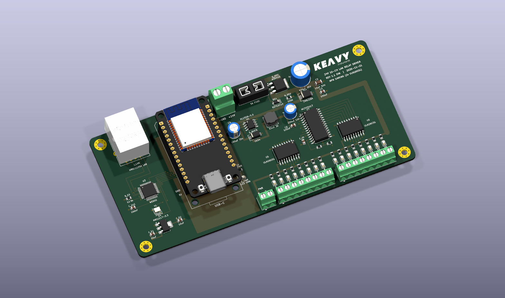
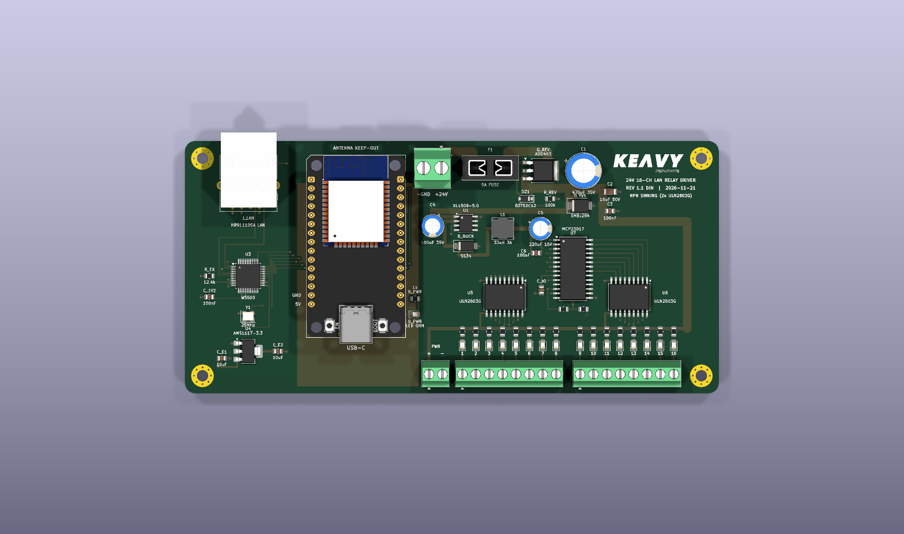

# 24V DC 16-Channel LAN ESPHome Relay Driver (REV 1.1 DIN)

An open-source, DIN-rail friendly **24V DC 16-Channel NPN Relay Driver** designed for **ESPHome** and **Home Assistant**, engineered to drive industrial **16-Channel (or 2× 8-Channel) 24VDC NPN PLC Relay Modules** (such as **Omron G2R-1-E 24VDC NPN**).

Built as an exact mechanical and core-architecture replica (`152.0 mm × 72.0 mm`, UM72 DIN-rail profile) of the 6-Channel LAN LED Dimmer board.

---

## Key Features

- **16 Independent NPN Sinking Relay Driver Channels (`CH1`–`CH16`)**:
  - **MCP23017** 16-bit I2C I/O Expander (`SOIC-28W`, address `0x20`) controlled via ESP32 I2C (`SDA=GPIO21`, `SCL=GPIO22`) — guarantees all 16 relays remain **OFF** during power-on/boot (zero chatter).
  - **2× ULN2803G (`ULN2803G-S18-R` SOP-18)** 8-channel NPN Darlington arrays (`50V / 500mA` per channel, built-in `2.7k` base resistors, internal `10.2k` pulldowns, and internal `COM` freewheeling clamp diodes tied to `+24V_BUS`).
  - Directly compatible with **24VDC NPN (Active-Low)** PLC relay modules such as **Omron G2R-1-E 16-Channel / 2× 8-Channel 24VDC NPN** (~21.8 mA coil current per channel, ~350 mA total for all 16 relays energized).
  - Dedicated **2-pin 3.81mm `+24V / GND` pass-through power terminal (`J2`)** + **2× 8-pin 3.81mm output terminals (`J3`: `CH1`–`CH8`, `J4`: `CH9`–`CH16`)**.
  - 16× onboard green **0805 status LEDs (`LED1`–`LED16`)** aligned directly above `CH1`–`CH16`.
- **Modular ESP32 Controller & Wired Ethernet LAN**:
  - Socketed **ESP32 DevKit V1 30-Pin (USB-C)** (`U2`) + **WIZnet W5500** (`U3`) + **HanRun HR911105A** RJ45 MagJack (`J_LAN`) + dedicated **AMS1117-3.3** (`U4`).
- **DIN-Rail Friendly Form Factor (`152.0 mm × 72.0 mm`)**:
  - **Top-Facing Ports**: RJ45 Ethernet (`J_LAN`) and 24V DC Power Input (`J1`, 5.08mm).
  - **Bottom-Facing Ports**: USB-C, Relay Power Output (`J2`), and 16-Channel NPN Outputs (`J3`, `J4`).
- **Industrial-Grade Protection & Onboard Step-Down**:
  - Reverse Polarity Protection (**AOD403** + **BZT52C12**), **5A Mini Blade Fuse** (`F1`), **SMBJ28A** TVS, and **XL1509-5.0** 24V→5V buck converter.

---

## Hardware Architecture & Pinout

| Subsystem | Pin / Address | Signal | Target |
|---|---|---|---|
| **W5500 Ethernet (SPI)** | `GPIO14, 25, 26, 27, 32, 33` | `CLK, MISO, MOSI, CS, RST, INT` | `U3` (W5500) |
| **MCP23017 (I2C `0x20`)** | `GPIO21` (Pad 26), `GPIO22` (Pad 29) | `I2C_SDA`, `I2C_SCL` (`4.7k` pull-ups) | `U7` (MCP23017) |
| **Channels 1–8 (`J3`)** | `MCP23017 GPB0..GPB7` (ESPHome pins `8..15`) | `RELAY_CH1..8` → `U5 (ULN2803G)` | `J3` Pins 1–8 (`CH1`–`CH8` NPN) |
| **Channels 9–16 (`J4`)** | `MCP23017 GPA0..GPA7` (ESPHome pins `0..7`) | `RELAY_CH9..16` → `U6 (ULN2803G)` | `J4` Pins 1–8 (`CH9`–`CH16` NPN) |
| **Relay Power Feed (`J2`)** | Protected `+24V_BUS` / `GND` | `PWR + / -` | Relay Module `DC+` / `DC-` |

---

## ESPHome Firmware & JLCPCB Manufacturing

- **Firmware**: [`firmware/relay_16ch.yaml`](firmware/relay_16ch.yaml) (`esphome run firmware/relay_16ch.yaml`)
- **Gerber ZIP**: [`manufacturing/jlcpcb/GERBER-relay_16ch.zip`](manufacturing/jlcpcb/GERBER-relay_16ch.zip)
- **JLCPCB BOM**: [`manufacturing/jlcpcb/BOM-relay_16ch.csv`](manufacturing/jlcpcb/BOM-relay_16ch.csv)
- **JLCPCB CPL**: [`manufacturing/jlcpcb/CPL-relay_16ch.csv`](manufacturing/jlcpcb/CPL-relay_16ch.csv)
- **DRC Report**: [`drc_report.json`](drc_report.json) (`0 violations`, `0 unconnected items`)
